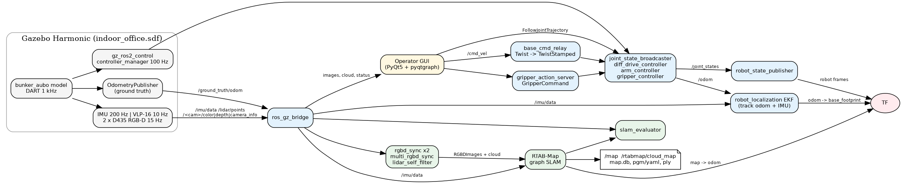
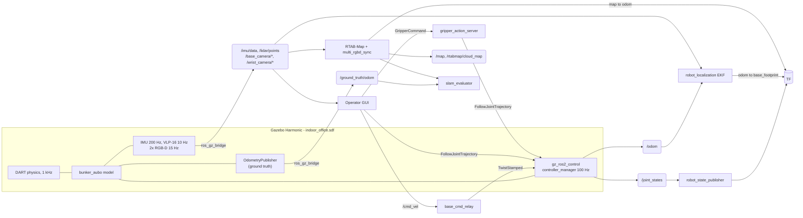
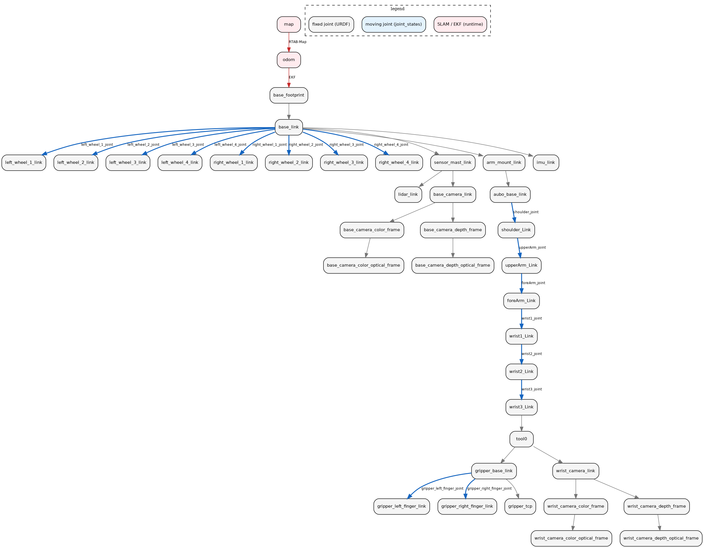
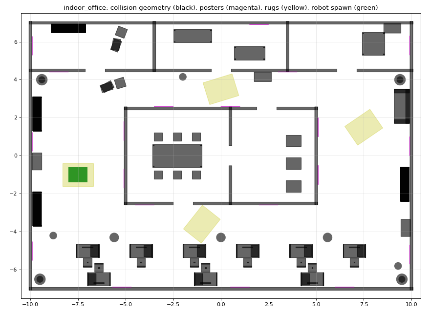

# bunker_aubo_sim

ROS 2 Jazzy + Gazebo Harmonic simulation of an AgileX BUNKER (tracked base) with an AUBO-i5 arm
and a simple parallel gripper. Sensors: IMU, Velodyne VLP-16, and two RealSense D435 (one on the
mast, one on the wrist). On top of that there is a Qt operator GUI, an RTAB-Map based SLAM setup
that uses all of the sensors, and Nav2 for autonomous navigation.

Tested on Ubuntu 24.04 / ROS 2 Jazzy / Gazebo Harmonic (`ros_gz`). Gazebo Classic is not used.



What is in here:

- **Robot model**: URDF/xacro of the BUNKER + AUBO-i5 + gripper with real meshes, inertias,
  joint limits, `ros2_control` for tracks, arm and gripper, and four simulated sensors
- **World**: an indoor office (corridor loop, meeting room, desks, pillars, textured posters)
- **Operator GUI** (PyQt5): drive the base, move the arm joint by joint or to named poses with
  a self-collision check, open/close the gripper, both camera feeds, the LiDAR cloud with a live
  3D robot model, and a topic health table
- **SLAM**: RTAB-Map fed by the LiDAR, both RGB-D cameras, the IMU and EKF track odometry;
  2D/3D map export, reload in localization mode, accuracy check against Gazebo ground truth
- **Navigation**: Nav2 with Smac 2D (A*) planner, Regulated Pure Pursuit, 3D voxel costmaps,
  localization by RTAB-Map or AMCL, named goals and a corridor patrol
- **Tests**: 109 unit tests and a GitHub Actions build/test workflow

Quick start (after [building](#build)):

```bash
ros2 launch bunker_aubo_bringup sim.launch.py              # simulation
ros2 launch bunker_aubo_gui gui.launch.py                  # operator GUI
ros2 launch bunker_aubo_slam slam.launch.py                # SLAM
ros2 launch bunker_aubo_bringup demo.launch.py             # all three together
ros2 launch bunker_aubo_navigation nav_demo.launch.py      # sim + GUI + SLAM + Nav2
tools/run_bunker.sh                                        # build + demo (--no-build, --clean)
```

Changes between versions are listed in [CHANGELOG.md](CHANGELOG.md).

## Build

```bash
# needs ROS 2 Jazzy + Gazebo Harmonic (ros-jazzy-desktop) already installed
sudo apt update
sudo apt install -y python3-colcon-common-extensions python3-rosdep python3-vcstool git
sudo rosdep init 2>/dev/null || true
rosdep update

mkdir -p ~/bunker_ws/src && cd ~/bunker_ws/src
git clone <this-repository-url> bunker_aubo_sim
cd ~/bunker_ws
vcs import src < src/bunker_aubo_sim/dependencies.repos # currently nothing to import, all deps are apt
rosdep install --from-paths src --ignore-src -y --rosdistro jazzy

colcon build --symlink-install
source install/setup.bash
```

rosdep pulls in everything from the package.xml files (ros_gz, gz_ros2_control,
ros2_controllers, robot_localization, rtabmap_ros, Nav2, pointcloud_to_laserscan, PyQt5,
pyqtgraph ...).
The full apt list is in [docs/apt_packages.txt](docs/apt_packages.txt).

On WSL2: update the NVIDIA driver on the Windows side, and if Gazebo comes up black try
`export GALLIUM_DRIVER=d3d12`. Give WSL at least 12 GB of RAM (`%UserProfile%\.wslconfig`:
`[wsl2] memory=12GB`).

## Running

```bash
# terminal 1: gazebo, robot, controllers, bridge, EKF, rviz
ros2 launch bunker_aubo_bringup sim.launch.py

# terminal 2: operator GUI
ros2 launch bunker_aubo_gui gui.launch.py

# terminal 3: SLAM (rviz shows /map, the 3D cloud and the path)
ros2 launch bunker_aubo_slam slam.launch.py

# drive around the central block with the GUI (W/A/S/D). Loop closures show up in the GUI
# and as "LOOP CLOSURE #n" in the log.

# save the maps (pgm/yaml, ply, rtabmap db, evaluation report)
ros2 run bunker_aubo_slam save_map.sh office ~/bunker_maps

# later: restart and localize in the saved map (db is not modified)
ros2 launch bunker_aubo_slam slam.launch.py localization:=true database_path:=~/bunker_maps/office.db
# or only serve the 2D map with map_server
ros2 launch bunker_aubo_slam load_map.launch.py map:=~/bunker_maps/office.yaml
```

Autonomous navigation (Nav2, details in [Navigation](#navigation-nav2)):

```bash
ros2 launch bunker_aubo_navigation nav_demo.launch.py          # sim + GUI + SLAM + Nav2 in one go
ros2 run bunker_aubo_navigation go_to north_corridor            # or "2D Goal Pose" in RViz
```

Useful launch arguments: `sim.launch.py gz_gui:=false` (headless, `--headless-rendering`),
`rviz:=false`, `x:= y:= yaw:=`, `sensors_config:=my.yaml`, and for SLAM
`rtabmap_viz:=true evaluate:=false resume:=true`.

There is also a live check script (run it while the sim is up):

```bash
ros2 run bunker_aubo_bringup smoke_check                              # topics, rates, frames, TF, IMU, lidar
ros2 run bunker_aubo_bringup smoke_check --ros-args -p active:=true   # also drives, moves the arm, uses the gripper
```

## Packages

```
bunker_aubo_sim/
├── bunker_aubo_description/   URDF/xacro, meshes, sensor config, display launch, URDF tests
│   ├── urdf/bunker_aubo.urdf.xacro        top level (args: sim_gazebo, controllers_config, sensors_config)
│   ├── urdf/bunker/ aubo/ gripper/ sensors/ control/ gazebo.xacro
│   ├── config/sensors.yaml                sensor rates / noise / resolution
│   ├── config/initial_positions.yaml      arm + gripper pose at spawn
│   └── bunker_aubo_description/urdf_model.py  small URDF parser + FK (no ROS needed)
├── bunker_aubo_gazebo/        indoor_office.sdf world, generator script, textures
├── bunker_aubo_bringup/       sim / demo / replay launch, controllers, bridge, EKF config,
│                              cmd_vel relay, gripper action server, smoke_check, record_bag.sh
├── bunker_aubo_gui/           PyQt5 + pyqtgraph operator GUI
├── bunker_aubo_slam/          slam launch, rtabmap.yaml, multi-camera sync, evaluator, map tools
├── bunker_aubo_navigation/    Nav2 params, navigation / nav_demo launch, RViz, goals + go_to tool
├── docs/                      architecture, TF tree, sensor mounts, SLAM notes, demo script, results
├── tools/                     run_bunker.sh (build + launch), collect_deliverables.sh,
│                              publish_to_github.sh
├── dependencies.repos
└── THIRD_PARTY_NOTICES.md
```

## Architecture


The same graph as a Mermaid chart:



Node table, SLAM data flow, full TF tree and timing: [docs/architecture.md](docs/architecture.md).

TF tree (from the URDF plus the EKF and SLAM transforms, regenerated with
`bunker_aubo_description/scripts/tf_tree_diagram.py`):



`docs/images/tf_view_frames.pdf` is the tree recorded from the running system with
`ros2 run tf2_tools view_frames`.

## Topics / interfaces

| What | Interface | Notes |
|---|---|---|
| Base command | `/cmd_vel` (`geometry_msgs/Twist`) | relayed to `/diff_drive_controller/cmd_vel` as TwistStamped (Jazzy controller). `/cmd_vel_stamped` works too |
| Base odometry | `/odom` (`nav_msgs/Odometry`) | from diff_drive_controller |
| Fused odometry | `/odometry/filtered`, TF `odom→base_footprint` | robot_localization EKF (tracks + IMU gyro) |
| Joint states | `/joint_states` | 16 joints (8 wheels, 6 arm, 2 fingers) |
| IMU | `/imu/data` | frame `imu_link` |
| LiDAR | `/lidar/points` (`PointCloud2`, x y z intensity ring) | frame `lidar_link` |
| Base camera | `/base_camera/color/image_raw`, `/base_camera/depth/image_rect_raw` | depth is `32FC1` in m, frame `base_camera_color_optical_frame` |
| Wrist camera | `/wrist_camera/color/image_raw`, `/wrist_camera/depth/image_rect_raw` | frame `wrist_camera_color_optical_frame` |
| Camera info | `/<cam>/color/camera_info`, `/<cam>/depth/camera_info` | |
| 2D map | `/map` (latched) | RTAB-Map grid, 5 cm |
| 3D map | `/rtabmap/cloud_map` (latched) | coloured cloud |
| SLAM pose | TF `map→odom→base_footprint`, `/rtabmap/localization_pose`, `/rtabmap/mapPath` | |
| SLAM status | `/rtabmap/info`, `/slam/evaluation` (JSON), `/slam/camera_status` (JSON) | |
| Arm | `/arm_controller/follow_joint_trajectory` (`control_msgs/FollowJointTrajectory`) | partial goals allowed |
| Gripper | `/gripper_controller/gripper_cmd` (`control_msgs/GripperCommand`) | `position` = finger gap in m, 0 to 0.08 |
| Ground truth | `/ground_truth/odom` | only used for evaluation |
| Clock | `/clock` | all nodes run with `use_sim_time: true` |

## Robot model

The xacro is split per module (base, arm, gripper, IMU, VLP-16, D435 macro, ros2_control, gazebo
plugins) and the top-level file just puts them together.

BUNKER: the AgileX body mesh (decimated from 285k to 23k triangles) is used as the visual. The
tracks themselves are not simulated; instead there are 4 road wheels per side (r = 75 mm) inside
the track shell, driven skid-steer style. The wheels have lower sideways friction (0.6) than
forward (1.0) so the robot slides when it turns, like a tracked vehicle does. Chassis and upper
track collisions sit above the 90 mm ground clearance so only the wheels touch the floor. More
on this choice in [docs/robot_model.md](docs/robot_model.md).

AUBO-i5: kinematics, inertias and meshes from the manufacturer's description, original joint
names. Limits ±3.04 rad, 150°/s on J1–J3 and 180°/s on J4–J6.

Gripper: two separate prismatic fingers (0–40 mm each, so 0–80 mm gap), used through a normal
`GripperCommand` action.

All physical links have inertia. Pure frames (`base_footprint`, `tool0`, `gripper_tcp`,
`*_optical_frame`) are massless, and the URDF tests check this. Sensor mounting transforms are in
[docs/sensor_mounting.md](docs/sensor_mounting.md) (generated from the URDF). Optical frames are
z forward, x right, y down.

Arm poses used in the GUI: `home` (all zero), `stowed` (spawn pose, folded below the lidar,
wrist camera looking forward), `ready` (tool down), `inspect` (wrist camera at about 1.1 m).

## Simulation

The world (`indoor_office.sdf`, 20 × 14 m) is a corridor loop around a central block with a
meeting room and a server room, three rooms to the north and an open office with desks and
pillars in the south. Shelves, sofas, plants, 20 textured posters and some rugs are there so the
cameras have something to match for loop closure. The SDF is generated by
`bunker_aubo_gazebo/scripts/generate_world.py` and a test checks that it is in sync.



There is also a much simpler world, `simple_room.sdf`: only the 20 × 14 m outer walls, two
pillars and two boxes (generated by `scripts/generate_simple_world.py`). With no textures the
cameras see little, so loop closure there relies on the lidar:

```bash
ros2 launch bunker_aubo_bringup simple.launch.py                         # sim + GUI + SLAM
ros2 launch bunker_aubo_bringup simple.launch.py gui:=false slam:=false  # sim only
```

Sensor noise and rates are all in `bunker_aubo_description/config/sensors.yaml`, so they can be
changed without touching the URDF.

`sim.launch.py` starts Gazebo with the world, robot_state_publisher, spawns the robot, starts the
bridge, then joint_state_broadcaster, then the diff drive / arm / gripper controllers (chained on
process exit so they don't start before the robot exists), the EKF, the cmd_vel relay and the
gripper action server. Robot transforms come from robot_state_publisher, `odom→base_footprint`
from the EKF and `map→odom` from SLAM.

## Operator GUI

`ros2 launch bunker_aubo_gui gui.launch.py` (`rviz:=true` opens RViz with the map as well).

- Base: hold-to-drive pad (with diagonals), speed sliders, keyboard driving (W/A/S/D or arrows,
  Space stops) and an E-STOP that latches zero velocity and cancels arm/gripper goals (`Esc` too).
  Commanded and measured velocity are shown.
- Arm: slider + number field per joint, limits read from `/robot_description` and every target
  is clamped. Buttons for move, copy actual to target, stop, live mode and the named poses. Move
  time is picked so no joint goes over 30 % of its velocity limit.
- Gripper: open / close, a width slider that moves the gripper when released (the "move with the
  slider" box switches that off, then use Set width), and the measured opening. Only the latest
  command runs; status shows done, holding object (fingers stopped on something) or did not reach.
- Sensors: both cameras side by side (RGB or depth), the lidar cloud in 3D together with the
  robot model (meshes from `/robot_description`, posed live from `/joint_states`, so the arm and
  gripper move in the view; the cloud is drawn in `base_footprint` and coloured by height above
  the floor; 2D top view if there's no OpenGL), and a table with rate and age of each topic
  (OK / STALE / NO DATA), plus SLAM status and loop closure count.

rclpy runs in a background `MultiThreadedExecutor`; callbacks only store the latest data and Qt
timers do the drawing, so the window doesn't freeze. If a topic stops the view shows
"SIGNAL LOST". The non-Qt logic has unit tests in `bunker_aubo_gui/test`.

## SLAM

Details and parameter choices: [docs/slam.md](docs/slam.md).

| Sensor | Used in | How |
|---|---|---|
| Track odometry | EKF | forward velocity, plus `vy = 0`. Yaw rate has a big covariance because the tracks slip in turns |
| IMU | EKF, RTAB-Map | gyro yaw rate for heading; gravity links in the graph |
| VLP-16 | RTAB-Map | ICP refinement of each odometry link (`RGBD/NeighborLinkRefining`) and of visual loop closures (`Reg/Strategy 2`), proximity closures, grid and 3D map |
| Base D435 | RTAB-Map | bag-of-words loop closure, PnP registration, grid + coloured 3D map |
| Wrist D435 | RTAB-Map | same as the base camera via the multi-camera input; its pose comes from TF (arm joints) at the image stamp |

The EKF gives smooth local odometry (`odom→base_footprint`) and RTAB-Map corrects it globally and
publishes `map→odom` (REP-105).

All data is stamped with Gazebo sim time. RGB and depth of one camera have the same stamp
(`rgbd_sync`), the two cameras are grouped by `multi_rgbd_sync` (within 50 ms), and RTAB-Map
syncs that with the lidar approximately. Every sensor transform is looked up at that message's
own stamp, which matters for the wrist camera since it moves with the arm.

RTAB-Map needs the camera count to stay the same, so if a camera is silent for more than 0.5 s
`multi_rgbd_sync` sends a blank frame for it (black, zero depth, same intrinsics). SLAM keeps
going on the lidar and the other camera and switches back when the stream returns
(`/slam/camera_status`). To try it:
`ros2 service call /slam/wrist_camera/enable std_srvs/srv/SetBool "{data: false}"` (`true` to undo).

Outputs: pose (TF `map→base_footprint`), `/map`, `/rtabmap/cloud_map`, `/rtabmap/mapPath`, the
database file (this is the saved map), and pgm/yaml + ply exports.

`slam_evaluator` compares against Gazebo ground truth: ATE of SLAM and of odometry alone, heading
error, jumps in the trajectory, and how close occupied map cells are to the real walls/furniture
from the SDF (plus how much of the walls is covered). Results go to `~/bunker_maps/evaluation/`
(CSV, JSON, Markdown, PNG). The numbers from the final run go in
[docs/results/README.md](docs/results/README.md).

## Navigation (Nav2)

`bunker_aubo_navigation` adds autonomous point-to-point navigation on top of the existing stack.
Nothing in the other packages changes: Nav2 reads the same TF tree, `/map` and LiDAR cloud, and
its velocity command goes into `/cmd_vel`, the same input the GUI uses.

| Part | Choice | Why |
|---|---|---|
| Global planner | Smac Planner 2D (cost-aware A* on the costmap grid, then smoothing) | keeps to the middle of 2 m corridors and 1.2 m doors (`cost_travel_multiplier`) |
| Local controller | Regulated Pure Pursuit | simple and stable for a skid-steer / tracked base; turns on the spot when the heading error is large, slows down near obstacles and in tight turns |
| Path smoother | Simple Smoother | removes the grid steps from the A* path |
| Recoveries | spin, back up, drive on heading, wait (behavior server) | default Nav2 behaviour tree |
| Costmaps | static layer (`/map`) + 3D voxel layer (self-filtered VLP-16) + inflation | the voxel layer clears with 3D rays, so low obstacles are not wiped by beams passing over them |
| Footprint | 1.08 x 0.84 m rectangle | measured from the URDF with the arm stowed |
| Velocity | velocity smoother, 0.5 m/s and 1.0 rad/s max | below the diff_drive_controller limits |

Localization has three modes (`localization:=`):

- `slam` (default): RTAB-Map keeps mapping and gives `map -> odom`. Nav2 plans in the growing map
  and may plan through unknown space, so it can be sent into areas not seen yet.
- `rtabmap`: RTAB-Map in localization mode on a saved database (`database_path:=`), map fixed.
- `amcl`: no RTAB-Map. `map_server` serves the saved 2D map (`map:=office.yaml`) and AMCL
  localizes with a 2D slice of the VLP-16 (`pointcloud_to_laserscan`, 0.2 to 1.5 m above the floor).
  A map saved with `save_map.sh` has its origin at the start pose, so starting the robot at the
  same spawn point needs no initial pose. Otherwise use "2D Pose Estimate" in RViz.

```bash
# everything in one command
ros2 launch bunker_aubo_navigation nav_demo.launch.py
ros2 launch bunker_aubo_navigation nav_demo.launch.py localization:=rtabmap database_path:=~/bunker_maps/office.db
ros2 launch bunker_aubo_navigation nav_demo.launch.py localization:=amcl map:=~/bunker_maps/office.yaml

# or Nav2 alone, with sim (and SLAM) already running
ros2 launch bunker_aubo_navigation navigation.launch.py localization:=slam

# goals: "2D Goal Pose" / Nav2 panel in RViz, or from a terminal
ros2 run bunker_aubo_navigation go_to --list
ros2 run bunker_aubo_navigation go_to meeting_room
ros2 run bunker_aubo_navigation go_to 2.0 -1.5 90        # x y yaw[deg] in the map frame
ros2 run bunker_aubo_navigation go_to --patrol --laps 2  # outer corridor, back to the start
```

Named goals are kept in world coordinates in `config/goals.yaml` (easy to read off the floor plan)
and converted to the map frame with the spawn pose; a test checks that each one is clear of the
world geometry with room to turn on the spot.

Manual driving and Nav2 share `/cmd_vel`, so cancel the Nav2 goal (RViz Nav2 panel or Ctrl+C on
`go_to`) before driving by hand. The GUI E-STOP holds the base at zero but does not cancel the
goal.

## Tests

```bash
colcon test && colcon test-result --verbose
```

- description: xacro expands (sim and display), links have visual/collision/valid inertia, joint
  limits, single root, meshes exist, wheels on the ground, sensor frames connected to
  `base_footprint`, optical frame convention, ros2_control interfaces, initial pose inside limits
  and clear of the deck and lidar
- gazebo: world parses, needed systems present, textures exist, SDF matches the generator
- bringup: controllers use real interfaces, diff drive geometry matches the URDF, bridge only
  bridges sensors that exist, EKF config, launch files compile
- gui: image/depth/cloud conversions (padding, encodings, NaN), limit clamping, move timing, URDF
  limit loading, topic health
- navigation: every Nav2 node has parameters, frames match EKF / RTAB-Map, footprint covers the
  robot and fits the doors, costmaps use the self-filtered cloud, velocity limits inside the base
  controller, Nav2 output reaches `/cmd_vel`, named goals are collision free
- slam: multi-camera sync (pairing, waiting, blank frames, reference switch, recovery), trajectory
  alignment / ATE, map vs world, PGM/PLY I/O, rtabmap and helper-node config, results report
  (never writes numbers that were not measured)

`smoke_check` covers the things that can only be checked live. CI (`.github/workflows/ci.yml`)
runs build + test in a `ros:jazzy` container.

## Deliverables

| # | Item | Where |
|---|---|---|
| 1 | Repository | this repo |
| 2 | URDF/xacro + meshes | `bunker_aubo_description/urdf`, `meshes` |
| 3 | World + sensor config | `bunker_aubo_gazebo/worlds`, `bunker_aubo_description/config/sensors.yaml`, `bunker_aubo_bringup/config/ros_gz_bridge.yaml` |
| 4 | GUI | `bunker_aubo_gui` |
| 5 | SLAM launch + params | `bunker_aubo_slam/launch`, `config/rtabmap.yaml`, `config/slam_nodes.yaml`, `bunker_aubo_bringup/config/ekf.yaml` |
| 6 | RViz configs | `*/rviz/*.rviz` |
| 7 | Dependencies | `dependencies.repos`, `docs/apt_packages.txt`, `package.xml` files |
| 8 | README | this file |
| 9 | Architecture / TF diagrams | `docs/images/architecture.png`, `docs/images/tf_tree.png`, `docs/images/tf_view_frames.pdf`, `docs/architecture.md` |
| 10 | Bag | recorded by `tools/collect_deliverables.sh` (mcap + zstd), link in `docs/results/README.md`. Replay with `ros2 launch bunker_aubo_bringup replay.launch.py` and `ros2 bag play <bag> --clock --remap /tf:=/tf_recorded /tf_static:=/tf_static_recorded` |
| 11 | Saved 2D/3D map | `docs/results/maps/` (pgm/yaml, ply, RTAB-Map db if under 50 MB) |
| 12 | Video | recorded following `docs/demo_script.md`, link in `docs/results/README.md` |

Items 10 to 12 and the accuracy table come from a live run. With the system running, one script
collects them:

```bash
tools/collect_deliverables.sh 300 office    # TF tree, 5 min bag while you drive the loop,
                                            # saved maps, evaluation, docs/results/README.md
```

## Troubleshooting

| Problem | What to try |
|---|---|
| Gazebo black or crashing (WSL) | update the Windows NVIDIA driver, `export GALLIUM_DRIVER=d3d12`, `wsl --update` |
| Camera / lidar topics exist but are empty | sensors need rendering: check `gz topic -l` lists `/lidar/points`, run with `gz_verbosity:=4` and look for ogre2 errors |
| Controllers time out on spawn | first start compiles shaders, just start again. `ros2 control list_controllers` |
| Real-time factor much below 1 | lower camera resolution/rate and lidar samples in `sensors.yaml`, `gz_gui:=false`, close RViz |
| Robot doesn't move | `ros2 topic echo /diff_drive_controller/cmd_vel`; check the E-STOP in the GUI |
| SLAM doesn't add nodes | `ros2 topic hz /rtabmap/rgbd_images /lidar/points`; nodes are only added after 10 cm / 0.1 rad of motion |
| No `map→odom` | SLAM isn't running. With only `sim.launch.py` use `odom` as fixed frame in RViz |

## Limitations / next steps

- Tracks are wheels. A `gz-sim-tracked-vehicle-system` model would be closer to real track–ground
  contact.
- Depth is perfectly aligned to colour and has no noise (Gazebo only adds noise to the RGB image).
  A real D435 needs its factory extrinsics and a depth noise model that grows with z².
- No motion planning for the arm yet. The GUI moves joints point to point and only refuses
  targets or straight joint-space paths that collide (box/point check in `self_collision.py`).
  MoveIt 2 (SRDF + OMPL on the same controllers) would be the next thing to add.
- Nav2 sees obstacles only through the VLP-16. Right next to the robot the lowest beam is high
  (about 0.67 m at 1 m distance), so very low objects are only seen from further away; adding the
  mast D435 depth cloud as a second voxel source would close that gap.
- Other ideas: a lidar-inertial front end (FAST-LIO2 / KISS-ICP), online
  extrinsic calibration, and a hardware bringup (BUNKER CAN driver, `aubo_driver`, `velodyne`,
  `realsense2_camera`) using the same topic names.

## Licence and third-party content

Original code is Apache-2.0 ([LICENSE](LICENSE)). BUNKER mesh from AgileX `ugv_gazebo_sim` (BSD), AUBO-i5
meshes/kinematics from `AuboRobot/aubo_robot` (BSD-3-Clause). Details and upstream commits in
[THIRD_PARTY_NOTICES.md](THIRD_PARTY_NOTICES.md).

## Author

Pradeep Nahak (praddepnahak2008@gmail.com). Issues and pull requests are welcome, see
[CONTRIBUTING.md](CONTRIBUTING.md). If you use this work, please cite it using
[CITATION.cff](CITATION.cff) (GitHub shows a "Cite this repository" button for it).
