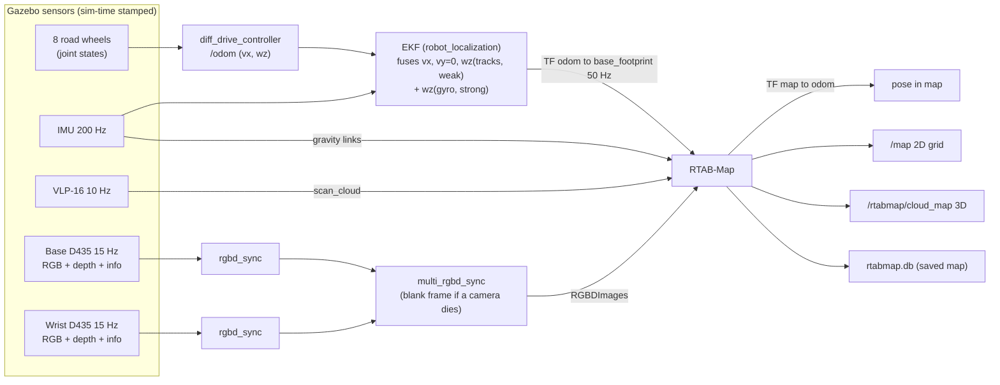
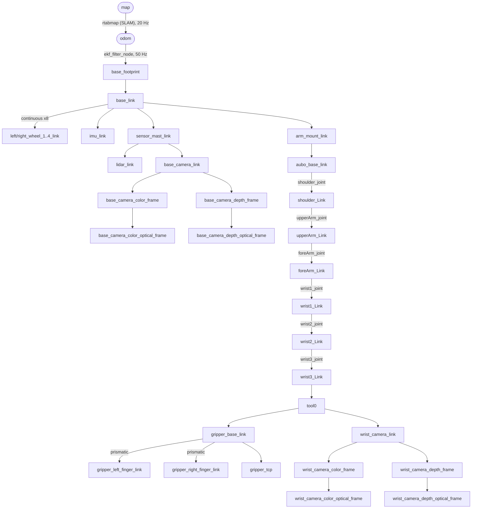

# Architecture

## 1. Process / node graph

| Process | Package | Started by | Role |
|---|---|---|---|
| `gz sim` (server + GUI) | Gazebo Harmonic | `sim.launch.py` via `ros_gz_sim/gz_sim.launch.py` | physics (DART, 1 kHz), rendering sensors (ogre2), IMU system |
| `gz_ros2_control` plugin | gz_ros2_control | model plugin (URDF `<gazebo>`) | hosts `/controller_manager` inside Gazebo (100 Hz) |
| `create` | ros_gz_sim | `sim.launch.py` | spawns the model from `/robot_description` |
| `robot_state_publisher` | robot_state_publisher | `sim.launch.py` | URDF → `/tf_static` (fixed joints) + `/tf` (movable joints from `/joint_states`) |
| `ros_gz_bridge` | ros_gz_bridge | `sim.launch.py` | `config/ros_gz_bridge.yaml`: clock, IMU, LiDAR, 2× RGB-D + camera_info, ground truth |
| `spawner` ×2 | controller_manager | `sim.launch.py` (event-chained) | `joint_state_broadcaster` → `diff_drive_controller`, `arm_controller`, `gripper_controller` |
| `ekf_filter_node` | robot_localization | `sim.launch.py` | `/odom` + `/imu/data` → `/odometry/filtered`, TF `odom→base_footprint` |
| `base_cmd_relay` | bunker_aubo_bringup | `sim.launch.py` | `/cmd_vel` (Twist) → `/diff_drive_controller/cmd_vel` (TwistStamped) |
| `gripper_action_server` | bunker_aubo_bringup | `sim.launch.py` | `GripperCommand` → 2-finger `FollowJointTrajectory` |
| `operator_gui` | bunker_aubo_gui | `gui.launch.py` | Qt console (ROS in a background executor thread) |
| `base_camera/rgbd_sync`, `wrist_camera/rgbd_sync` | rtabmap_sync | `slam.launch.py` | RGB + depth + info → `RGBDImage` (JPEG/PNG-compressed) |
| `rtabmap/multi_rgbd_sync` | bunker_aubo_slam | `slam.launch.py` | 2 × `RGBDImage` → `RGBDImages`, drop-out tolerant |
| `rtabmap/rtabmap` | rtabmap_slam | `slam.launch.py` | graph SLAM, `map→odom`, `/map`, `/rtabmap/cloud_map` |
| `slam_evaluator` | bunker_aubo_slam | `slam.launch.py` | loop-closure log, ATE + map accuracy vs ground truth |

## 2. Data flow of the SLAM subsystem

Inside RTAB-Map, for every new node (at most 1 Hz, and only after 10 cm or 0.1 rad of motion):

1. **Odometry link:** the pose change since the last node comes from TF `odom→base_footprint`,
   looked up at the node timestamp.
2. **Neighbour refinement (LiDAR):** the link is refined by point-to-plane ICP between the two
   VLP-16 scans (`RGBD/NeighborLinkRefining`). This removes most track-slip drift.
3. **Loop closure detection (cameras):** visual words from *both* cameras are compared against
   the memory (bag-of-words, `Rtabmap/LoopThr`). A hypothesis is verified by PnP on the
   RGB-D features, then refined by ICP on the LiDAR scans (`Reg/Strategy 2`).
4. **Proximity detection (LiDAR):** nodes close in space are matched by ICP even without visual
   similarity (`RGBD/ProximityBySpace`), which is important in feature-poor corridors.
5. **Graph optimisation:** GTSAM/g2o over odometry + loop + proximity links + IMU gravity
   links. Links whose error is too large are rejected (`RGBD/OptimizeMaxError`).
6. **Maps:** local occupancy grids from LiDAR and both depth images (robot body filtered out
   by footprint) are re-projected with the optimised poses into the global `/map` and
   `/rtabmap/cloud_map`.

## 3. TF tree

* `map → odom`: published only by SLAM (none while only the simulation runs). It is discontinuous
  when a loop closes; that is its purpose.
* `odom → base_footprint`: continuous, drifts slowly (EKF).
* All robot-internal transforms come from the URDF through robot_state_publisher. Fixed joints are
  on `/tf_static`; the arm, gripper and wheel joints are on `/tf` from `/joint_states`.
* Live TF PDF: `ros2 run tf2_tools view_frames` (writes `frames_*.pdf`).
* Exact numbers: [sensor_mounting.md](sensor_mounting.md).

## 4. Timing and synchronisation

| Stream | Rate | Stamp source |
|---|---|---|
| `/clock` | every physics step (1 kHz) | Gazebo |
| `/imu/data` | 200 Hz | Gazebo sim time at measurement |
| `/lidar/points` | 10 Hz | sim time at the end of the render; the whole scan shares one stamp (no motion distortion modelled) |
| camera RGB + depth + info | 15 Hz | identical stamp for RGB and depth of the same camera |
| `/joint_states`, `/odom` | 100 Hz / 50 Hz | controller_manager update (sim time) |
| `odom→base_footprint` | 50 Hz | EKF, sim time |
| `map→odom` | 20 Hz | RTAB-Map (`tf_delay` 0.05 s) |

* Every node runs with `use_sim_time: true`. With the real robot, the same launch works with
  `use_sim_time:=false` and hardware-timestamped drivers (PTP for the VLP-16).
* The two cameras are grouped by `multi_rgbd_sync` (closest stamps within 50 ms). RTAB-Map
  approximately syncs that group with the LiDAR (queue 30). It then transforms each sensor into
  `base_footprint` with TF **at that sensor's own timestamp**. The wrist camera therefore uses
  the arm pose at the moment the image was taken.
* The EKF keeps a history and handles slightly out-of-order IMU/odometry messages. The
  `sensor_timeout` (0.2 s) makes it predict through short gaps.
